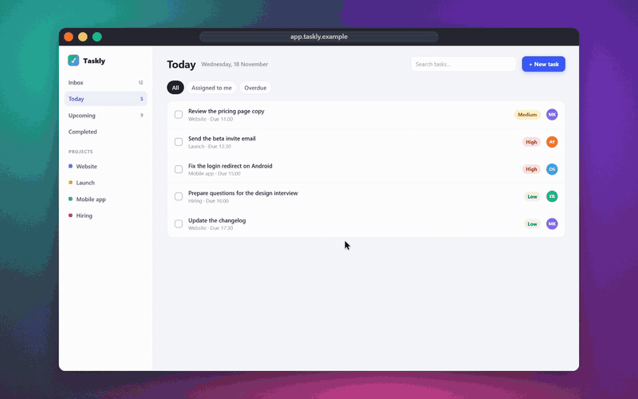
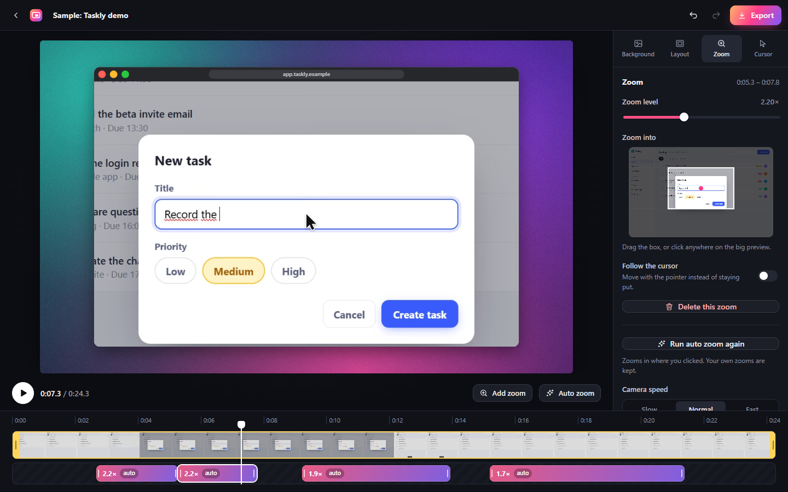
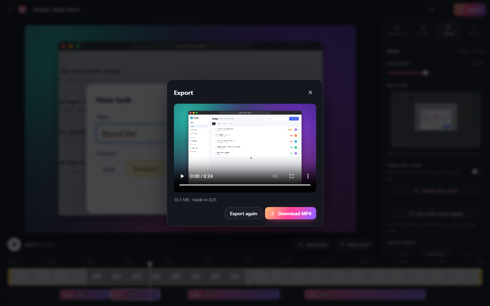

<p align="center">
  
</p>

<h1 align="center">Clipglow</h1>

<p align="center">
  <strong>Screen recordings that look amazing. Right in your browser.</strong><br>
  Auto zoom, smooth camera moves, beautiful backgrounds, a webcam bubble and MP4 export.<br>
  Free and open source. Nothing to install, nothing uploaded.
</p>

<p align="center">
  <a href="https://arda-dd.github.io/clipglow/"><strong>Open Clipglow →</strong></a>
</p>

<p align="center">
  <a href="https://github.com/Arda-dd/clipglow/actions/workflows/ci.yml"></a>
  <a href="LICENSE"></a>
  
</p>

<p align="center">
  
</p>
<p align="center"><sub>The sample recording, edited by Clipglow. Every zoom and the pointer were added automatically.</sub></p>

## Why Clipglow?

Raw screen recordings are hard to watch: the screen is huge, the text is tiny and nobody knows where to look. Tools
like Screen Studio fix that with zooms and polish, but they are paid and only run on a Mac.

Clipglow does it in the browser, on any computer:

- **Record, or bring your own video.** Record a window, a tab or your whole screen with your voice and your webcam.
  Or drop in a video you already have, from OBS, the Snipping Tool, QuickTime or Loom.
- **It finds the zooms for you.** Clipglow looks at what happens on screen and zooms in where it matters: typing, a
  menu opening, a toggle. It even ignores your mouse pointer while it looks.
- **Smooth like a camera operator.** Zooms ease in and out with spring physics and glide from one spot to the next
  instead of jumping.
- **Private.** Your video never leaves your computer. No account, no upload, no watermark.

## Features

<p align="center"></p>

**Recording**
- Screen, window or tab, with the sound of what you share and your microphone mixed in
- Webcam recorded separately, so its corner, size and shape can still change after recording
- 3, 2, 1 countdown, pause and resume

**Editing**
- **Auto zoom** from what moves on screen, or from clicks when the recording has cursor data
- Add a zoom with one click on the timeline (or press <kbd>Z</kbd>), drag to move it, drag its edges to change its length
- Pick the zoom level and the spot to zoom into, or let it follow the cursor
- Trim the start and the end
- Undo and redo everything

**Looks**
- 12 wallpapers, any solid color or your own image with blur
- Padding, rounded corners, shadow
- macOS or browser window frame with your own title or address
- Sizes for every platform: original, 16:9, 9:16 (Reels, Shorts, TikTok), 1:1, 4:5 (LinkedIn, Instagram) and 4:3
- Webcam as a circle, rounded square or square, in any corner, mirrored, smaller while zoomed in
- A smooth, larger pointer with click ripples for recordings with cursor data

**Export**
- MP4 (H.264 and AAC) up to 4K at 60 fps, WebM, or GIF for your README
- Uses WebCodecs, so your graphics card does the work. A minute of 1080p takes about a minute or less on a typical laptop.

<p align="center"></p>

## How auto zoom works

Most tools need to know where you clicked, which only works for recordings they made themselves. Clipglow also works
from the picture alone, so it can edit any video:

1. The video is decoded at a low resolution (320 pixels wide, 8 frames a second) with WebCodecs.
2. Each pixel is replaced by the **median of itself 0.25 seconds before and after**. A moving mouse pointer only passes
   through a pixel, so it disappears. Typed text and an opened menu stay, so they remain.
3. Consecutive cleaned frames are compared. Changes that stay in a small area for a while become a zoom, sized so the
   area fills about 60% of the view. Changes that cover a big part of the screen, like scrolling or a new page, end a
   zoom instead, because zooming into them would only show part of what is going on.
4. The camera moves to each zoom with a **critically damped spring**: a soft start, a soft stop and no overshoot.
   Zooms close together are joined by a pan, so the view glides instead of zooming out and back in.

The camera path is simulated once per edit at 120 steps a second, so jumping to any moment in the preview gives
exactly the same frame as playing up to it, and the export matches the preview frame for frame.

## Keyboard shortcuts

| Key | Action |
| --- | --- |
| <kbd>Space</kbd> | Play or pause |
| <kbd>Z</kbd> | Add a zoom at the playhead |
| <kbd>Delete</kbd> | Delete the selected zoom |
| <kbd>←</kbd> <kbd>→</kbd> | Step one frame (hold <kbd>Shift</kbd> for one second) |
| <kbd>Ctrl</kbd> + <kbd>Z</kbd> | Undo |
| <kbd>Ctrl</kbd> + <kbd>Shift</kbd> + <kbd>Z</kbd> | Redo |
| <kbd>Esc</kbd> | Deselect |

## Browser support

Clipglow is built on [WebCodecs](https://developer.mozilla.org/en-US/docs/Web/API/WebCodecs_API) and screen capture.
It is developed and tested in **Chrome and Edge** on desktop. Recent Firefox and Safari have WebCodecs too and may
work for opening and exporting videos; reports are welcome. Recording needs a desktop browser.

## Run it yourself

Clipglow is a static site. Any web server will do.

```bash
git clone https://github.com/Arda-dd/clipglow.git
cd clipglow
npm install
npm run dev        # http://localhost:5173
npm run build      # static files in dist/
```

Screen capture only works on `https://` pages and on `localhost`.

## Development

```bash
npm test           # unit tests (Vitest)
npm run typecheck  # TypeScript
```

```
src/
  core/            everything that isn't UI, and is tested
    camera.ts      the spring camera and the cursor smoothing
    autozoom.ts    motion analysis and zoom suggestions
    render.ts      draws one frame: background, window, zoom, cursor, webcam
    media.ts       reading, analyzing and exporting video (Mediabunny, WebCodecs)
    record.ts      screen, microphone and webcam recording
    storage.ts     projects in IndexedDB
  ui/              React components
scripts/
  make-sample.cjs  records the sample video and its cursor data
  showcase.cjs     makes the README images and the demo video, with Clipglow itself
```

The preview and the export use the same `Renderer`, so what you see is what you get.

## Roadmap

- A Chrome extension that records the cursor and clicks in any tab, for click zooms and the smooth pointer in your
  own recordings
- Cutting out parts in the middle, and speeding parts up
- Captions, generated on your computer
- Keyboard shortcut overlays

Ideas and pull requests are welcome. Please open an issue first for bigger changes.

## FAQ

**Is my video uploaded anywhere?**
No. Recording, editing and exporting all happen in your browser. Projects are saved in your browser's storage
(IndexedDB) and stay on your computer.

**Where are my projects?**
In this browser, on this computer. Clearing the site data removes them. Export anything you want to keep.

**Can I use the videos commercially?**
Yes. There is no watermark, and Clipglow is MIT licensed.

**Why is my export slow?**
Exporting uses your graphics card through WebCodecs. Without hardware acceleration (some virtual machines, or turned
off in the browser settings) it falls back to the processor, which is slower. A smaller size or 30 fps helps.

**Why are the cursor effects missing in my recording?**
Browsers don't tell web pages where the pointer is on other windows, so your own recordings show the pointer as it
was recorded. Cursor effects work for recordings that come with cursor data, like the sample. The Chrome extension
on the roadmap will add that.

## Thanks

Built with [Mediabunny](https://mediabunny.dev) for reading and writing video, [gifenc](https://github.com/mattdesl/gifenc)
for GIFs, and React. The app in the sample recording is made up.

## License

[MIT](LICENSE)
